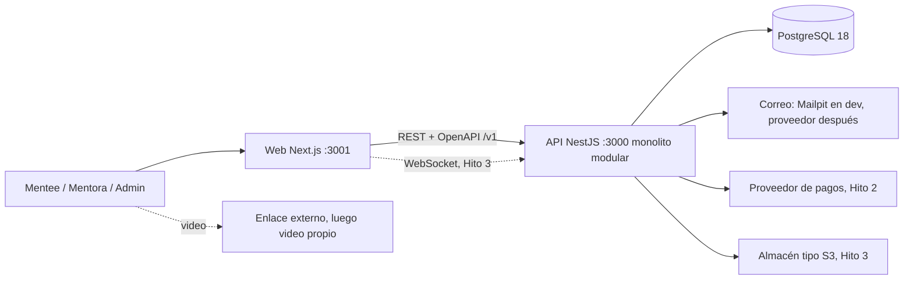

# 02 · Arquitectura

## Decisión
Monolito modular en NestJS (una sola app desplegable, módulos por contexto delimitado) con **hexagonal selectiva**: solo donde hay proveedores intercambiables o lógica pura que conviene aislar. El resto usa capas simples (controller → service → acceso a datos). Ver ADR-004 y ADR-005 en `07-DECISIONS.md`.

Dos aplicaciones, dos repositorios: este repo (API) y el repo web (Next.js). Se comunican por REST + OpenAPI y WebSocket (Hito 3). Carpeta contenedora local: `steam-society/`.

## Vista de contenedores


## Contextos (módulos)
| Contexto | Responsabilidad | Estilo | Hito |
|---|---|---|---|
| `identity` | Cuentas, autenticación, sesiones, roles, recuperación de contraseña | Capas (zona roja) | 1.2 |
| `profiles` | Perfiles de mentora y mentee, onboarding, áreas, idiomas, aprobación; lectura del catálogo | Capas | 1.3 y 1.6 |
| `scheduling` | Disponibilidad, ofertas, sesiones, reservas, cálculo de slots | **Hexagonal** (zona roja) | 1.4 y 1.5 |
| `matching` | Recomendaciones explicables | Función pura + módulo fino | 1.6 |
| `notifications` | Correos y avisos | Servicio simple; puerto cuando haya 2.º proveedor | 1.2 en adelante |
| `admin` | Endpoints de backoffice protegidos por rol, dentro de los módulos dueños | Capas | 1.3 |
| `payments` | Cobros, comisión, pagos, ledger, webhooks | **Hexagonal** (zona roja) | 2 |
| `messaging` | Chat en tiempo real | Capas + gateway WebSocket | 3 |
| `media` | Archivos y fotos | Servicio simple | 3 |
| `trust` | Reseñas, reportes, bloqueos | Capas | 3 |

`health` es un módulo técnico (no de negocio) y vive en `src/health/`.

1.5 separa el caso de uso de reservas en `src/modules/bookings/` (mismo contexto de `scheduling`, módulo Nest propio) para aislar la máquina de estados y las transacciones de reserva del cálculo de slots. `bookings` depende de `scheduling` (repositorio y puertos exportados) y de `profiles` (perfil de mentee), sin leer sus tablas.

## Estructura de carpetas
```text
src/
  main.ts · app.module.ts
  config/                    validación de variables de entorno
  shared/                    núcleo compartido SIN lógica de negocio
    prisma/                  PrismaService, PrismaModule (NO global)
    time/                    Temporal/IANA (temporal-polyfill, ADR-020)
    errors/ · money/ · clock/ · pagination/
  health/                    módulo técnico
  generated/prisma/          cliente generado (NO se versiona)
  modules/
    profiles/                (capas)
      profiles.controller.ts · profiles.service.ts · profiles.schemas.ts · profiles.module.ts (ADR-017)
    auth/                    identidad y sesiones (1.2)
      auth.controller.ts · auth.service.ts · auth.schemas.ts · auth.module.ts
    scheduling/              (hexagonal)
      domain/                reglas puras: sin Nest ni Prisma
      application/           casos de uso y puertos (interfaces)
      infrastructure/        adaptadores (repositorios Prisma, reloj)
      presentation/          controllers y DTOs
      scheduling.module.ts
    bookings/                (hexagonal, 1.5)
      domain/                máquina de estados de la reserva
      application/           casos de uso y puertos
      infrastructure/        repositorio Prisma, correo y tarea de vencimiento
      presentation/          controllers y esquemas Zod
      bookings.module.ts
prisma/
  schema.prisma · migrations/
docs/
```
En módulos hexagonales el dominio NUNCA importa Prisma ni Nest: se traduce en la frontera entre infraestructura y dominio.

## Reglas entre módulos
1. Cada módulo es dueño de sus tablas. Otro módulo no las lee ni las escribe: usa el servicio exportado del módulo dueño o escucha sus eventos de dominio.
2. Excepción: claves foráneas hacia `user` (integridad referencial).
3. Dependencias permitidas (flecha = "puede depender de"): `scheduling → profiles`, `bookings → scheduling, profiles`, `matching → profiles, scheduling`, `payments → scheduling` (por evento), `notifications ← eventos de todos`. Nadie depende de `admin`. Evita ciclos; si aparece uno, se detiene y se pregunta.
4. Efectos laterales entre módulos: en el Hito 1 no hay bus de eventos; el caso de uso confirma la transacción y después llama a `NotificationsPort` (ADR-022). El outbox se decide en el Hito 2.
5. `PrismaModule` NO es global: cada módulo que accede a datos lo importa.
6. Se vigila con una regla de lint o dependency-cruiser cuando haya 3 o más módulos [a confirmar herramienta].

## Hexagonal en la práctica
- **Puerto**: interfaz definida por el núcleo (ej. `Clock`, `BookingRepository`, `PaymentGateway`).
- **Adaptador**: implementación con tecnología concreta (Prisma, proveedor de pagos, correo). Hay además adaptadores falsos para tests.
- **Regla para crear un puerto**: solo si hay una segunda implementación real o falsa para tests, o un proveedor que probablemente cambie. Si no, no se crea.
- **Ejemplo 1.4**: `MentorSettingsPort` vive en `scheduling` y `ProfilesMentorSettingsAdapter` lo implementa llamando al servicio exportado de `profiles`; así `scheduling` no lee `mentor_profile` ni `user`.
- La lógica de dominio son funciones y clases puras, testeables sin base de datos.

## Flujo de una petición (módulo de capas)
`Controller` (HTTP, validación, DTO) → `Service` (regla de negocio, transacción) → `PrismaService` → PostgreSQL. Los errores de dominio se lanzan como excepciones propias y un filtro global los traduce a HTTP (ver `06-CONVENTIONS.md`).

## Tiempo real y tareas en segundo plano (Hitos 1 y 3)
- Vencimiento de solicitudes y recordatorios: tarea programada simple en proceso con `@nestjs/schedule` (ADR-023), además de evaluarse al consultar para no depender de la tarea. La actualización de vencimiento es idempotente.
- WebSockets (chat y señalización): gateway dentro del mismo proceso de la API. Video: Hito 4.

## Calidad y evidencia por capa
- Dominio: tests unitarios rápidos con Vitest.
- Acceso a datos e invariantes: tests de integración contra PostgreSQL real (Docker), base de pruebas separada.
- API: tests de extremo a extremo de los flujos críticos.
- Concurrencia: tests con peticiones simultáneas para reservas.
