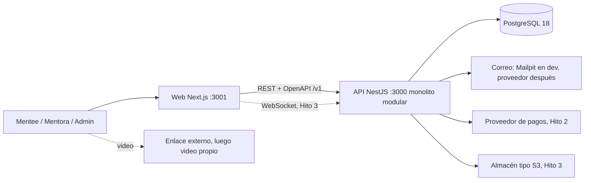

# 02 · Arquitectura

## Decisión
Monolito modular en NestJS (una sola app desplegable, módulos por contexto delimitado) con **hexagonal selectiva**: solo donde hay proveedores intercambiables o lógica pura que conviene aislar. El resto usa capas simples (controller → service → acceso a datos). Ver ADR-004 y ADR-005 en `07-DECISIONS.md`.

Dos aplicaciones, dos repositorios: este repo (API) y el repo web (Next.js). Se comunican por REST + OpenAPI y WebSocket (Hito 3). Carpeta contenedora local: `steam-society/`.

## Vista de contenedores


## Contextos (módulos)
Módulos que existen hoy en `src/`:

| Contexto | Responsabilidad | Estilo | Hito |
|---|---|---|---|
| `auth` | Cuentas, autenticación, sesiones, roles, guards globales, recuperación de contraseña y correo (`MailerService`) | Plano: controller, service, repository (zona roja) | 1.2 |
| `profiles` | Perfiles de mentora y mentee, onboarding, áreas, idiomas, aprobación (incluye los endpoints `/admin/mentors`); señales tipadas para catálogo y matching | Plano, con `domain/` solo para la máquina de estados | 1.3 y 1.6 |
| `scheduling` | Disponibilidad, ofertas y cálculo de slots | **Hexagonal** (zona roja) | 1.4 |
| `bookings` | Sesiones y reservas: máquina de estados, transacciones, vencimiento y avisos por correo (`NotificationsPort` con `MailNotificationsAdapter`) | **Hexagonal** (zona roja) | 1.5 |
| `catalog` | Catálogo público de mentoras: búsqueda, filtros, detalle y ofertas | Capas parciales (`application` y `presentation`) | 1.6 |
| `matching` | Recomendaciones explicables | Función pura + módulo fino | 1.6 |
| `payments` | Cobros, comisión y webhooks | **Hexagonal** (zona roja) | Esqueleto desacoplado 2026-11-16 (ADR-025); proveedor real, ledger y reembolsos en el Hito 2 |
| `health` | Estado de la API y la base | Módulo técnico en `src/health/` | 1.1a |

Futuros (aún no existen en `src/`):

| Contexto | Responsabilidad | Estilo | Hito |
|---|---|---|---|
| `messaging` | Chat en tiempo real | Capas + gateway WebSocket | 3 |
| `media` | Archivos y fotos | Servicio simple | 3 |
| `trust` | Reseñas, reportes, bloqueos | Capas | 3 |

No hay módulos `identity`, `notifications` ni `admin`: el backoffice vive en `profiles` y el correo en `auth` (`MailerService`) y `bookings` (`NotificationsPort`). Un puerto de notificaciones compartido se crea cuando haya un segundo proveedor.

1.5 separa el caso de uso de reservas en `src/modules/bookings/` (mismo contexto de `scheduling`, módulo Nest propio) para aislar la máquina de estados y las transacciones de reserva del cálculo de slots. `bookings` depende de `scheduling` (repositorio y puertos exportados) y de `profiles` (perfil de mentee), sin leer sus tablas.

1.6 añade dos módulos: `catalog` compone la búsqueda de `profiles` con las ofertas activas de `scheduling` para la vista pública, y `matching` compone las señales de ambos con una función pura de recomendación. Ninguno obliga a `profiles` a depender de `scheduling`; la composición vive en los módulos de lectura.

## Estructura de carpetas
```text
src/
  main.ts · app.module.ts · app.setup.ts   (Helmet, CORS, sesiones, CSRF)
  config/                    validación de variables de entorno
  shared/                    núcleo compartido SIN lógica de negocio
    prisma/                  PrismaService, PrismaModule (NO global)
    clock/                   puerto Clock y SystemClock
    config/                  orígenes web (WEB_ORIGIN)
    http/                    decoradores @Public y @Roles, cookie de sesión
    time/                    Temporal/IANA (temporal-polyfill, ADR-020)
  health/                    módulo técnico
  generated/prisma/          cliente generado (NO se versiona)
  modules/
    auth/                    (plano, 1.2) identidad, sesiones, guards globales y MailerService
      auth.controller.ts · auth.service.ts · auth.schemas.ts · user.repository.ts · auth.module.ts
    profiles/                (plano, 1.3; domain/ solo con mentor-status) incluye /admin/mentors
      profiles.controller.ts · profiles.service.ts · profiles.repository.ts · profiles.schemas.ts · profiles.module.ts (ADR-017)
    scheduling/              (hexagonal)
      domain/                reglas puras: sin Nest ni Prisma
      application/           casos de uso y puertos (interfaces)
      infrastructure/        adaptadores (repositorios Prisma, reloj)
      presentation/          controllers y DTOs
      scheduling.module.ts
    bookings/                (hexagonal, 1.5)
      domain/                máquina de estados de la reserva
      application/           casos de uso y puertos
      infrastructure/        repositorio Prisma, correo y tarea de vencimiento
      presentation/          controllers y esquemas Zod
      bookings.module.ts
    catalog/                 (capas parciales, 1.6)
      application/           composición de perfiles + ofertas
      presentation/          controller y esquema público
      catalog.module.ts
    matching/                (función pura + módulo fino, 1.6)
      domain/                recommend(), tipos y configuración
      application/           carga de señales y recomendaciones
      presentation/          controller y esquema
      matching.module.ts
    payments/                (hexagonal, ADR-025)
      domain/ · application/ (con ports/) · infrastructure/ · presentation/
      payments.module.ts
prisma/
  schema.prisma · migrations/
docs/
```
En módulos hexagonales el dominio NUNCA importa Prisma ni Nest: se traduce en la frontera entre infraestructura y dominio.

## Reglas entre módulos
1. Cada módulo es dueño de sus tablas. Otro módulo no las lee ni las escribe: usa el servicio exportado del módulo dueño o escucha sus eventos de dominio.
2. Excepción: claves foráneas hacia `user` (integridad referencial).
3. Dependencias permitidas (flecha = "puede depender de"), tal como las fija `ALLOWED` en `scripts/check-boundaries.mjs`: `auth → (nadie)`, `profiles → auth`, `scheduling → auth, profiles`, `bookings → auth, profiles, scheduling`, `catalog → profiles, scheduling`, `matching → auth, profiles, scheduling`, `payments → auth, bookings` (la dependencia de datos va por `BookingPaymentPort`; bookings no conoce payments), `health → (nadie)`. Todos pueden usar `shared`, `config` y `generated`. `auth` aparece como dependencia de casi todos por decoradores y tipos (`CurrentUser`, `AuthUser`). Nadie depende de `payments`, `catalog` ni `matching`. Evita ciclos; una flecha nueva exige un ADR y falla el lint hasta registrarla. Si aparece un ciclo, se detiene y se pregunta.
4. Efectos laterales entre módulos: en el Hito 1 no hay bus de eventos; el caso de uso confirma la transacción y después llama a `NotificationsPort` (ADR-022). El outbox se decide en el Hito 2.
5. `PrismaModule` NO es global: cada módulo que accede a datos lo importa.
6. Se vigila con `scripts/check-boundaries.mjs`, que corre dentro de `pnpm lint`.

## Hexagonal en la práctica
- **Puerto**: interfaz definida por el núcleo (ej. `Clock`, `BookingRepository`, `PaymentGateway`).
- **Adaptador**: implementación con tecnología concreta (Prisma, proveedor de pagos, correo). Hay además adaptadores falsos para tests.
- **Regla para crear un puerto**: solo si hay una segunda implementación real o falsa para tests, o un proveedor que probablemente cambie. Si no, no se crea.
- **Ejemplo 1.4**: `MentorSettingsPort` vive en `scheduling` y `ProfilesMentorSettingsAdapter` lo implementa llamando al servicio exportado de `profiles`; así `scheduling` no lee `mentor_profile` ni `user`.
- La lógica de dominio son funciones y clases puras, testeables sin base de datos.

## Flujo de una petición (módulo de capas)
`Controller` (HTTP, validación, DTO) → `Service` (regla de negocio, transacción) → `PrismaService` → PostgreSQL. Los errores de dominio se lanzan como excepciones propias y un filtro global los traduce a HTTP (ver `06-CONVENTIONS.md`).

## Tiempo real y tareas en segundo plano (Hitos 1 y 3)
- Vencimiento de solicitudes y recordatorios: tarea programada simple en proceso con `@nestjs/schedule` (ADR-023), además de evaluarse al consultar para no depender de la tarea. La actualización de vencimiento es idempotente.
- WebSockets (chat y señalización): gateway dentro del mismo proceso de la API. Video: Hito 4.

## Calidad y evidencia por capa
- Dominio: tests unitarios rápidos con Vitest.
- Acceso a datos e invariantes: tests de integración contra PostgreSQL real (Docker), base de pruebas separada.
- API: tests de extremo a extremo de los flujos críticos.
- Concurrencia: tests con peticiones simultáneas para reservas.
