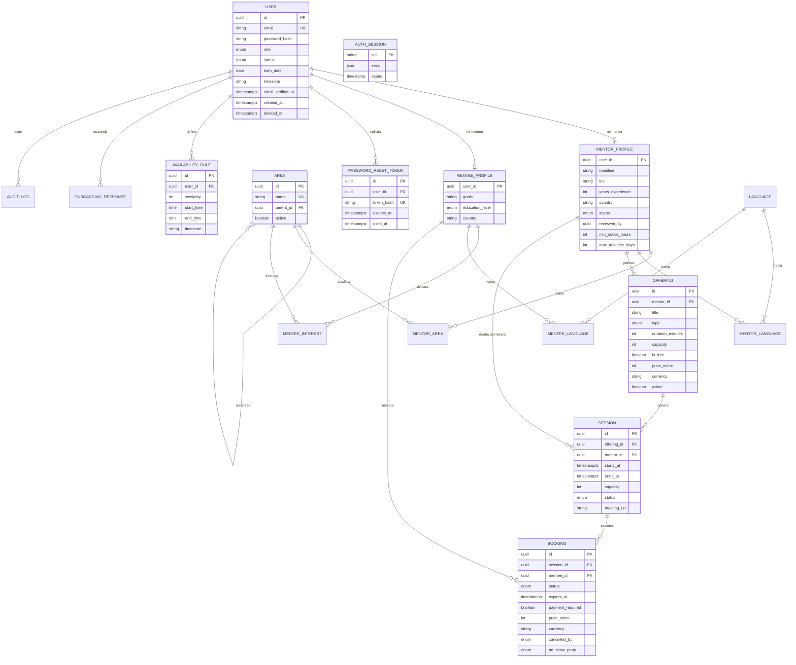
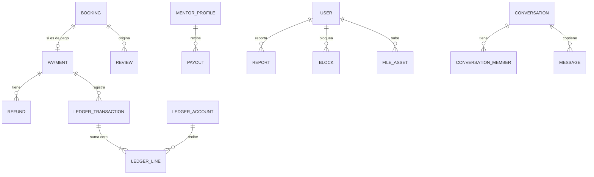

# 03 · Modelo de datos (PostgreSQL 18 + Prisma 7)

El esquema completo es el MAPA. Las migraciones llegan por etapa (sección "Migraciones por etapa"); no se crean tablas de hitos futuros.

## Principios
- Tablas y columnas en `snake_case`; en Prisma, modelos `PascalCase` con `@@map("snake_case")` y campos `camelCase` con `@map("snake_case")`. Tablas en singular.
- IDs `uuid` v7 generados por la base con `uuidv7()` (`@default(dbgenerated("uuidv7()"))`), ordenados por tiempo (P-08 aceptada; función nativa de PostgreSQL 18).
- Fechas: `timestamptz` en UTC (`@db.Timestamptz(3)`); `created_at`/`updated_at` en tablas mutables. Reglas recurrentes: hora local (`time`) + zona IANA (`text`).
- Dinero: entero en unidad mínima (`amount_minor`) + `currency` (ISO 4217, `char(3)`). Nunca float ni decimal.
- Estados como enums de PostgreSQL. Taxonomías (áreas, idiomas) como tablas editables.
- Correo normalizado a minúsculas en la aplicación; índice único sobre `email`.
- Borrado: `deleted_at` en `user` (anonimización a petición; ver DA-04). Registros financieros y `audit_log` son inmutables.
- Restricciones que Prisma no expresa (exclusión, CHECK, columnas generadas) se escriben a mano con `prisma migrate dev --create-only` y se editan en el SQL [verificado en documentación de Prisma].

## Diagrama ER: Hito 1

## Diagrama ER: hitos 2 y 3 (solo relaciones; NO crear todavía)

## Diccionario de tablas: Hito 1
Enums: `user_role(mentee, mentor, admin)` · `user_status(pending_verification, active, suspended, deleted)` · `mentor_status(draft, pending_review, approved, rejected, suspended)` · `education_level(school, undergraduate, graduate, career_change, other)` · `offering_type(one_to_one, group)` · `session_status(open, cancelled, completed)` · `booking_status(requested, awaiting_payment, confirmed, declined, cancelled, expired, completed, no_show)` · `cancel_actor(mentee, mentor, admin, system)` · `no_show_party(mentee, mentor)`.

**identity**
- `user`: `id`, `email` (UK, minúsculas; CHECK `email = lower(email)`), `password_hash` (null si la autenticación es externa), `role`, `status`, `first_name`, `last_name`, `birth_date` (date; obligatoria en el registro, nula solo para admins de seed; DA-01; CHECK `user_birth_date_required_check`), `timezone` (IANA, default `America/Lima`), `locale` (default `es`), `email_verified_at`, `created_at`, `updated_at`, `deleted_at`.
- `auth_session`: `sid` (varchar PK), `sess` (json), `expire` (timestamp(6)); la usa `connect-pg-simple` para las sesiones de autenticación. Se llama `auth_session`, no `session`, porque `session` queda reservado para las sesiones de mentoría de la etapa 1.5. No tiene FK: el `userId` vive dentro del JSON de `sess`; la revocación masiva se hace con SQL sobre `sess->>'userId'`.
- `password_reset_token`: `id` (uuid v7), `user_id` (FK a `user`, `ON DELETE CASCADE`), `token_hash` (UK; SHA-256 hexadecimal del token, nunca el token en claro), `expires_at` (`timestamptz(3)`, 1 hora), `used_at` (`timestamptz(3)`, un solo uso), `created_at`. El token se consume de forma atómica (`UPDATE ... WHERE used_at IS NULL`).
- `consent` (reservada para DA-04, no crear aún).

**profiles**
- `area`: `id` (uuid v7), `name` (UK global en el MVP), `parent_id` (null = área raíz; autorrelación con `ON DELETE RESTRICT`), `active` (default `true`), `created_at` (`timestamptz(3)`).
- `language`: `code` (PK, ISO 639-1: `es`, `en`, `qu`…), `name`.
- `mentor_profile`: `user_id` (PK y FK a `user`, 1:1), `headline`, `bio`, `years_experience`, `country` (ISO 3166-1 alfa-2), `city`, `status`, `reviewed_by` (FK a `user`), `reviewed_at`, `rejection_reason`, `min_notice_hours` (default 24), `max_advance_days` (default 60), `created_at`, `updated_at`. Columna `search_vector` (tsvector generada) llega en 1.6.
- `mentee_profile`: `user_id` (PK y FK), `goals`, `education_level`, `country`, `city`, `created_at`, `updated_at`.
- `mentor_area(mentor_id, area_id)`, `mentee_interest(mentee_id, area_id)`, `mentor_language(mentor_id, language_code)`, `mentee_language(mentee_id, language_code)`: claves primarias compuestas.
- `onboarding_response`: `id`, `user_id`, `question_code`, `answer` (jsonb), `version`, `created_at`. UK `(user_id, question_code)`. Las señales del matching NO viven en JSON: van en relaciones y columnas tipadas.

**scheduling**
- `availability_rule`: `id`, `user_id` (mentora o mentee), `weekday` (1=lunes … 7=domingo, ISO), `start_time`, `end_time` (hora local), `timezone` (IANA), `valid_from`, `valid_to` (fechas, opcionales), `created_at`. CHECK `end_time > start_time`.
- `offering`: `id`, `mentor_id` (FK a `mentor_profile`), `title`, `description`, `type` (en el MVP la API solo crea `one_to_one`), `duration_minutes`, `capacity` (1 para `one_to_one`), `is_free`, `price_minor`, `currency`, `active`, `archived_at`, `created_at`, `updated_at`. CHECK: `is_free` ⇒ `price_minor = 0`; no `is_free` ⇒ `price_minor > 0`; `duration_minutes` entre 15 y 240 [PLACEHOLDER]; `capacity >= 1`.
- `session`: `id`, `offering_id`, `mentor_id` (denormalizado para la restricción de exclusión), `starts_at`, `ends_at`, `capacity`, `status`, `meeting_url` (enlace externo en el Hito 1), `created_at`. CHECK `ends_at > starts_at`.
- `booking`: `id`, `session_id`, `mentee_id`, `status`, `message` (nota de la mentee), `requested_at`, `responded_at`, `expires_at`, `confirmed_at`, `cancelled_at`, `cancelled_by`, `cancel_reason`, `completed_at`, `no_show_party`, `payment_required` (copia de la oferta al solicitar), `price_minor` y `currency` (copias al solicitar), `created_at`, `updated_at`.

**admin**
- `audit_log`: `id`, `actor_user_id`, `action`, `entity_type`, `entity_id`, `metadata` (jsonb), `created_at`. Solo se insertan filas.

## Hitos 2 y 3: esqueleto (referencia, no implementar aún)
- **payments**: `payment` (`booking_id` UK, `provider`, `provider_ref` UK, `status`, `amount_minor`, `currency`, `fee_bps` y `fee_minor` copiados al cobrar, `net_minor`, `idempotency_key` UK), `refund`, `payout`, `webhook_event` (`provider`, `event_id`, UK `(provider, event_id)`, `payload`, `processed_at`).
- **ledger**: `ledger_account` (`code` UK, ej. `provider_clearing`, `platform_revenue`, `mentor_payable:<id>`), `ledger_transaction` (`kind`, `ref_type`, `ref_id`, `idempotency_key` UK), `ledger_line` (`transaction_id`, `account_id`, `direction` debit|credit, `amount_minor > 0`, `currency`). Ejemplo: cobro de 100 con 10 % de comisión → débito `provider_clearing` 100; crédito `mentor_payable` 90; crédito `platform_revenue` 10. La comisión del proveedor y los impuestos [a confirmar con un contador].
- **trust**: `review` (`booking_id`, `reviewer_id`, `rating` 1..5, `comment`, visibilidad), `report`, `block`.
- **messaging**: `conversation`, `conversation_member`, `message`. **media**: `file_asset` (`owner_id`, `kind`, `storage_key`, `mime`, `size`, `sha256`, `status`, `visibility`).

## Invariantes (lo que NUNCA puede romperse)
| Invariante | Protección | Evidencia exigida |
|---|---|---|
| Una mentora no tiene dos sesiones activas solapadas (R-15) | Restricción de exclusión sobre `session` | Test con dos peticiones simultáneas: una gana, otra falla |
| No se supera la capacidad de la sesión ni se repite el asiento | UK parcial `(session_id, mentee_id)` para estados activos + bloqueo `FOR UPDATE` de la sesión en transacción | Test concurrente |
| Una mentee no tiene dos reservas activas solapadas (R-12) | Comprobación en la transacción de reserva | Test |
| Solo transiciones de estado válidas | Función pura de dominio | Test de la tabla de transiciones |
| Oferta gratuita ⇒ precio 0; de pago ⇒ precio > 0 | CHECK | Test de integración |
| Gratuita no tiene pago asociado (R-07) | `payment_required = false` y el módulo payments solo reacciona a reservas de pago | Test |
| Cada transacción del ledger suma cero por moneda; las líneas son inmutables (Hito 2) | Restricción diferida y bloqueo de UPDATE y DELETE | Test de invariantes |
| Un webhook se procesa una sola vez (Hito 2) | UK `(provider, event_id)` | Test de reenvío duplicado |

SQL a mano previsto (migraciones `--create-only`): extensión `btree_gist` y restricción `EXCLUDE USING gist (mentor_id WITH =, tstzrange(starts_at, ends_at, '[)') WITH &&) WHERE (status <> 'cancelled')` sobre `session`; los CHECK anteriores; en 1.6, extensión `pg_trgm`, columna `search_vector` generada e índices GIN. Prisma admite índices parciales con `where` en el schema [verificado en notas de versión; confirmar sintaxis en la documentación v7].

## Índices mínimos
`user(email)` UK · `mentor_profile(status)` · `offering(mentor_id, active)` · `session(mentor_id, starts_at)` · `booking(mentee_id, status)` · `booking(session_id, status)` · `availability_rule(user_id, weekday)` · `audit_log(entity_type, entity_id)`.

## Migraciones por etapa
| Etapa | Tablas nuevas |
|---|---|
| 1.1a | `area` |
| 1.2 | `user`, `auth_session`, `password_reset_token` |
| 1.3 | `language`, `mentor_profile`, `mentee_profile`, `mentor_area`, `mentee_interest`, `mentor_language`, `mentee_language`, `onboarding_response`, `audit_log` |
| 1.4 | `availability_rule`, `offering` |
| 1.5 | `session`, `booking` + SQL a mano (exclusión y CHECK) |
| 1.6 | `search_vector` y extensiones de búsqueda |
| 2 / 3 | Ver esqueleto arriba |

Regla: nunca editar una migración ya aplicada; se crea otra. Cada migración lleva un nombre descriptivo (ej. `add_area`).
