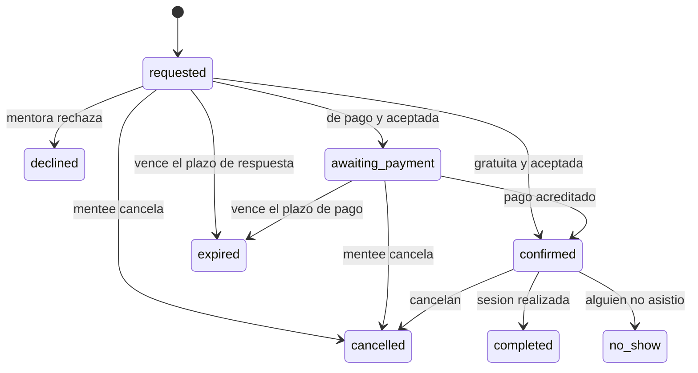
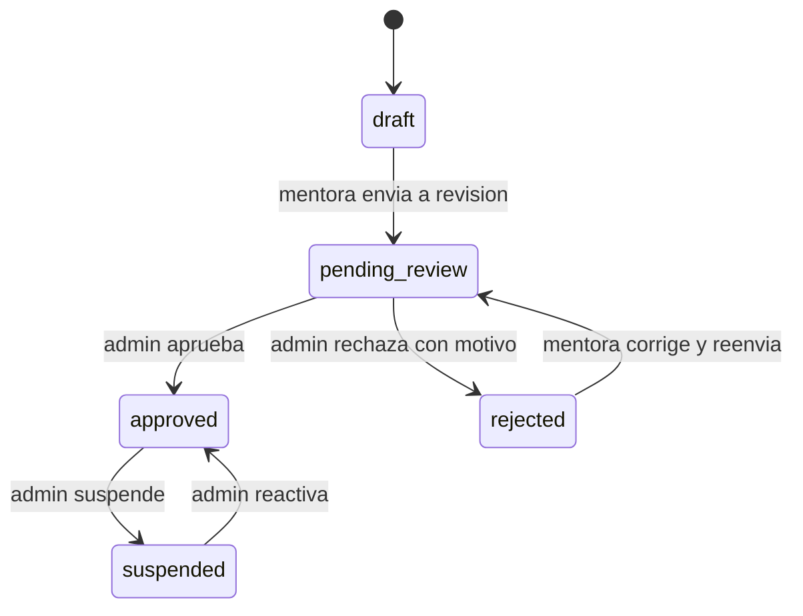

# 04 · Máquinas de estado

Cada máquina vive como **función pura de dominio** (`(estadoActual, evento, contexto) → nuevoEstado | error`), testeada con una tabla exhaustiva de transiciones válidas e inválidas. Ninguna transición se hace con un `UPDATE` suelto.

## Reserva (`booking`)

Estados terminales: `declined`, `cancelled`, `expired`, `completed`, `no_show`. Estados activos (ocupan el asiento): `requested`, `awaiting_payment`, `confirmed`.

| Desde | Evento | Hacia | Quién | Guardas | Efectos |
|---|---|---|---|---|---|
| (nuevo) | solicitar | `requested` | mentee | Mentora `approved`, oferta activa, horario dentro de la disponibilidad y de la antelación mínima y máxima, sin solapes (R-12, R-15), capacidad libre | Crea `session` (1:1) y `booking` en una transacción; fija `expires_at` (R-06); copia `payment_required`, `price_minor` y `currency` de la oferta; notifica a la mentora |
| `requested` | aceptar (gratuita) | `confirmed` | mentora | `payment_required = false` | `confirmed_at`; registra el enlace externo (`meetingUrl`) que aporta la mentora; notifica a ambas |
| `requested` | aceptar (de pago) | `awaiting_payment` | mentora | `payment_required = true` (Hito 2) | Deja la reserva a la espera del pago; el plazo de pago y el pago se definen en el Hito 2 |
| `requested` | rechazar | `declined` | mentora | Motivo opcional | Libera la sesión 1:1 (`session` → `cancelled`); notifica a la mentee |
| `requested` / `awaiting_payment` | cancelar | `cancelled` | mentee | Antes de confirmar | Libera la sesión; registra `cancelled_by` y `cancelled_at` |
| `requested` / `awaiting_payment` | vencer | `expired` | sistema | `now > expires_at` | Libera la sesión; notifica. Se evalúa al consultar y por una tarea periódica; la actualización es idempotente (ADR-023) |
| `awaiting_payment` | pago acreditado | `confirmed` | sistema (evento de payments) | Pago `paid` | Igual que aceptar gratuita |
| `confirmed` | cancelar | `cancelled` | mentee o mentora | Gratuita: hasta el inicio. De pago: **política pendiente (DA-05)** | Registra `cancelled_by` y `cancel_reason`; libera la sesión 1:1; reembolso según DA-05 (Hito 2); cuenta para la reputación |
| `confirmed` | completar | `completed` | sistema o mentora | `now >= ends_at` | `completed_at`; habilita reseñas (Hito 3) |
| `confirmed` | no-show | `no_show` | mentora (ausente mentee) o mentee (ausente mentora) | `now > starts_at` | Registra `no_show_party`; cuenta para la reputación |

Cuidados con sesiones gratuitas: más no-shows y ningún pago asociado. Los no-shows y cancelaciones tardías de mentees alimentan una señal de fiabilidad (Hito 3, `trust`).

Notificaciones: se envían después del commit vía `NotificationsPort`; un fallo de correo se registra y NO revierte la reserva (ADR-022). El plazo de respuesta sale de `BOOKING_REQUEST_TTL_HOURS` (ADR-021).

Implementación 1.5:
- La tabla de transiciones es una función pura en `src/modules/bookings/domain/booking-status.ts`, con test exhaustivo de todos los pares estado/evento y de las guardas temporales (`expire`, `complete`, `no_show`).
- Cada transición se ejecuta con `UPDATE booking SET ... WHERE id = ? AND status = <estado leído>` dentro de una transacción; si el estado cambió, responde `409 BOOKING_STATUS_CONFLICT`. La `session` asociada se actualiza en la misma transacción (`cancelled` o `completed`).
- La creación de la solicitud valida disponibilidad y antelación con el generador de slots de 1.4 y crea `session` + `booking` en una transacción con locks de asesoría por mentee y mentora. La exclusión `session_no_overlap` y el índice único parcial de asiento son la red de seguridad.
- Aceptar una reserva gratuita exige `meetingUrl` (la API no genera enlaces); una de pago pasa a `awaiting_payment` sin crear pago. El plazo de pago queda pendiente del Hito 2: por ahora `expires_at` conserva el TTL de la solicitud.
- `decline` guarda el motivo en `cancel_reason`; `cancel` guarda `cancelled_by`, `cancelled_at` y el motivo. Una reserva gratuita confirmada solo se puede cancelar antes de `starts_at`; la política de cancelación de reservas de pago queda pendiente (DA-05). `complete` y `no-show` marcan la sesión como `completed`.
- El vencimiento se evalúa en cada lectura/acción (`expireById`) y por una tarea `@Interval(60_000)` (`expireDue`); ambas actualizaciones son idempotentes y liberan la sesión. Una reserva vencida responde `409 BOOKING_EXPIRED` al intentar actuar sobre ella.
- Las notificaciones se envían después de la transacción; si fallan, solo se registra el nombre del error y la reserva sigue siendo válida.

## Sesión (`session`)
`open` → `cancelled` | `completed`. En 1:1 la sesión nace con la solicitud y se cancela cuando su única reserva termina sin confirmarse o se cancela. En grupales (futuro) sigue `open` mientras haya reservas válidas. En 1.5 la sesión se crea y se actualiza desde el repositorio de `bookings`; `PrismaSessionConflictAdapter` solo lee las sesiones no canceladas para el cálculo de slots.

## Perfil de mentora (`mentor_profile.status`)

Solo `approved` es visible en el catálogo y recomendaciones (R-02). Cada transición hecha por un admin escribe en `audit_log`.

Implementación 1.3:
- La tabla de transiciones vive en `src/modules/profiles/domain/mentor-status.ts` como función pura y tiene un test exhaustivo de todos los pares estado/evento.
- `submit`, `approve`, `reject`, `suspend` y `reactivate` se ejecutan en una transacción con `UPDATE ... WHERE status = <estado leído>`; si otra petición cambió el estado, responde `409 MENTOR_STATUS_CONFLICT`.
- También se audita el envío de la mentora (`mentor_profile.submitted`), no solo las acciones del admin.
- Decisión de producto: el perfil es editable en cualquier estado; editar no cambia `status`. Un perfil `approved` puede seguir editándose y el admin conserva `suspend` como control.

## Pago (`payment`), Hito 2 (borrador, afinar en el spike de dinero)
`created → pending → paid → (refunded_partial | refunded | disputed)`, y `failed` desde `created` o `pending`. Reglas: idempotencia por `idempotency_key`; los webhooks se registran antes de procesarse y solo una vez por `(provider, event_id)`; cada cambio de estado que mueva dinero escribe su transacción en el ledger. La conciliación contra el proveedor es diaria [a confirmar].

## Tests exigidos
- Tabla exhaustiva: cada par (estado, evento) válido produce el estado esperado; los inválidos lanzan un error de dominio específico.
- Concurrencia: dos solicitudes simultáneas al mismo horario de la misma mentora → una `requested` y la otra rechazada por conflicto.
- Vencimiento: una solicitud pasada de plazo se trata como `expired` aunque la tarea periódica no haya corrido.
