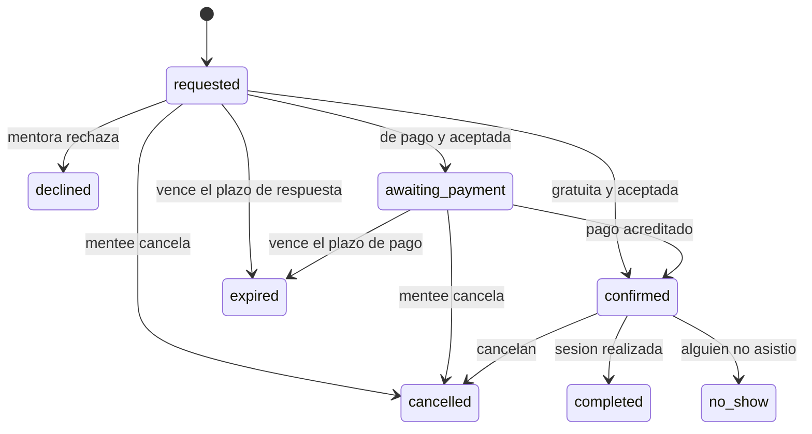
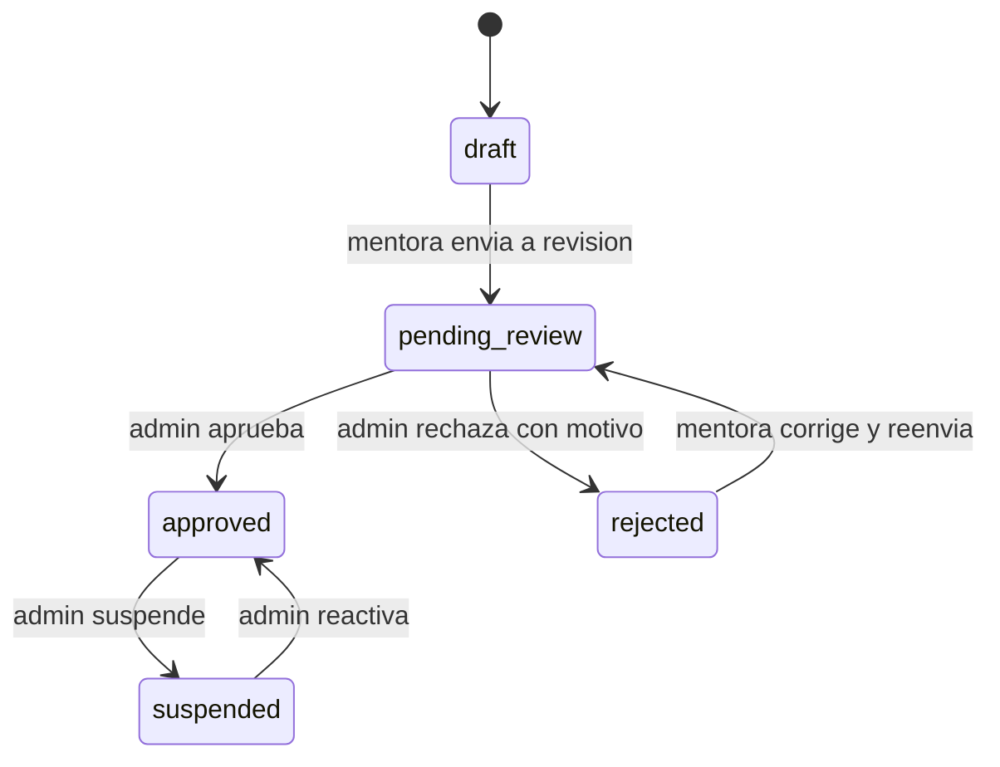

# 04 · Máquinas de estado

Cada máquina vive como **función pura de dominio** (`(estadoActual, evento, contexto) → nuevoEstado | error`), testeada con una tabla exhaustiva de transiciones válidas e inválidas. Ninguna transición se hace con un `UPDATE` suelto.

## Reserva (`booking`)

Estados terminales: `declined`, `cancelled`, `expired`, `completed`, `no_show`. Estados activos (ocupan el asiento): `requested`, `awaiting_payment`, `confirmed`.

| Desde | Evento | Hacia | Quién | Guardas | Efectos |
|---|---|---|---|---|---|
| (nuevo) | solicitar | `requested` | mentee | Mentora `approved`, oferta activa, horario dentro de la disponibilidad y de la antelación mínima y máxima, sin solapes (R-12, R-15), capacidad libre | Crea `session` (1:1) y `booking` en una transacción; fija `expires_at` (R-06); copia `payment_required`, `price_minor` y `currency` de la oferta; notifica a la mentora |
| `requested` | aceptar (gratuita) | `confirmed` | mentora | `payment_required = false` | `confirmed_at`; genera el enlace de la sesión; notifica a ambas |
| `requested` | aceptar (de pago) | `awaiting_payment` | mentora | `payment_required = true` (Hito 2) | Fija el plazo de pago; el módulo payments crea el pago (evento) |
| `requested` | rechazar | `declined` | mentora | Motivo opcional | Libera la sesión 1:1 (`session` → `cancelled`); notifica a la mentee |
| `requested` / `awaiting_payment` | cancelar | `cancelled` | mentee | Antes de confirmar | Libera la sesión; registra `cancelled_by` y `cancelled_at` |
| `requested` / `awaiting_payment` | vencer | `expired` | sistema | `now > expires_at` | Libera la sesión; notifica. Se evalúa al consultar y por una tarea periódica |
| `awaiting_payment` | pago acreditado | `confirmed` | sistema (evento de payments) | Pago `paid` | Igual que aceptar gratuita |
| `confirmed` | cancelar | `cancelled` | mentee o mentora | Gratuita: hasta el inicio. De pago: **política pendiente (DA-05)** | Registra `cancelled_by` y `cancel_reason`; libera la sesión 1:1; reembolso según DA-05 (Hito 2); cuenta para la reputación |
| `confirmed` | completar | `completed` | sistema o mentora | `now >= ends_at` | `completed_at`; habilita reseñas (Hito 3) |
| `confirmed` | no-show | `no_show` | mentora (ausente mentee) o mentee (ausente mentora) | `now > starts_at` | Registra `no_show_party`; cuenta para la reputación |

Cuidados con sesiones gratuitas: más no-shows y ningún pago asociado. Los no-shows y cancelaciones tardías de mentees alimentan una señal de fiabilidad (Hito 3, `trust`).

## Sesión (`session`)
`open` → `cancelled` | `completed`. En 1:1 la sesión nace con la solicitud y se cancela cuando su única reserva termina sin confirmarse o se cancela. En grupales (futuro) sigue `open` mientras haya reservas válidas.

## Perfil de mentora (`mentor_profile.status`)

Solo `approved` es visible en el catálogo y recomendaciones (R-02). Cada transición hecha por un admin escribe en `audit_log`.

## Pago (`payment`), Hito 2 (borrador, afinar en el spike de dinero)
`created → pending → paid → (refunded_partial | refunded | disputed)`, y `failed` desde `created` o `pending`. Reglas: idempotencia por `idempotency_key`; los webhooks se registran antes de procesarse y solo una vez por `(provider, event_id)`; cada cambio de estado que mueva dinero escribe su transacción en el ledger. La conciliación contra el proveedor es diaria [a confirmar].

## Tests exigidos
- Tabla exhaustiva: cada par (estado, evento) válido produce el estado esperado; los inválidos lanzan un error de dominio específico.
- Concurrencia: dos solicitudes simultáneas al mismo horario de la misma mentora → una `requested` y la otra rechazada por conflicto.
- Vencimiento: una solicitud pasada de plazo se trata como `expired` aunque la tarea periódica no haya corrido.
