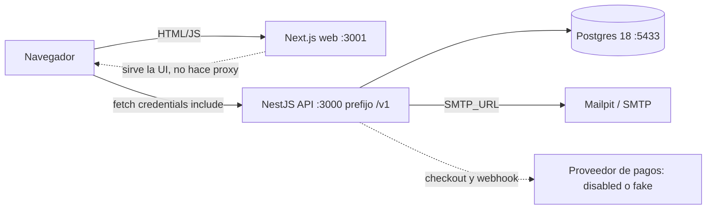
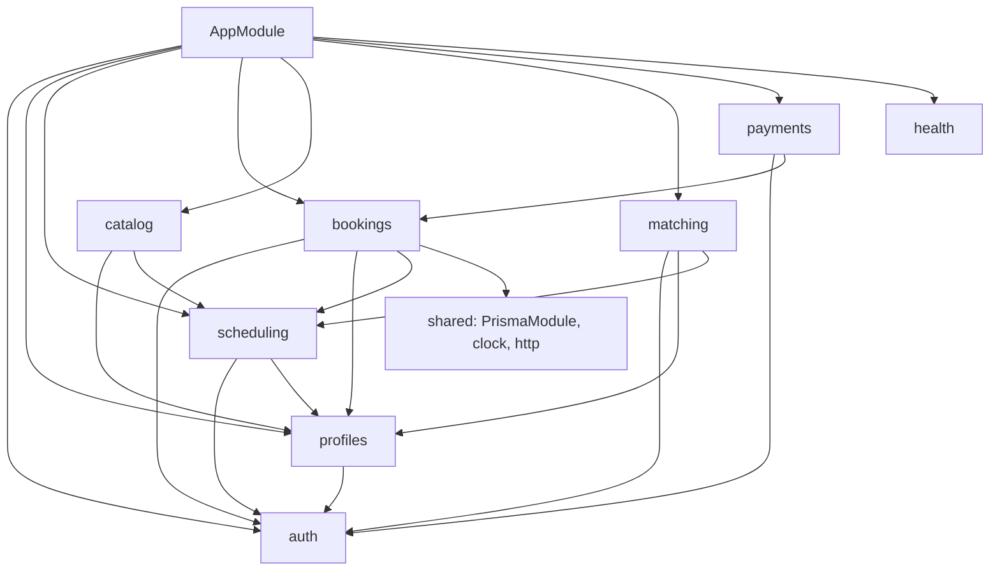
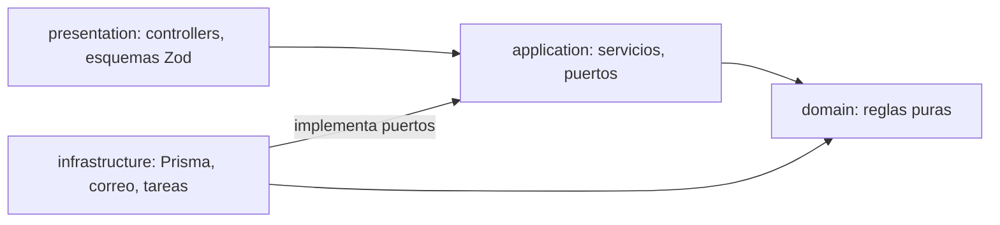
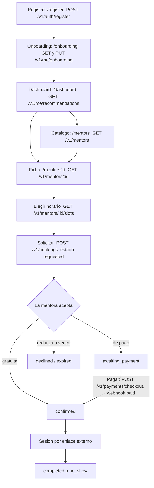
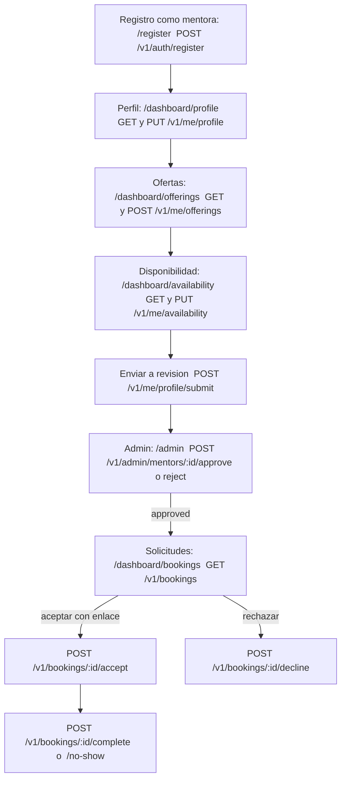
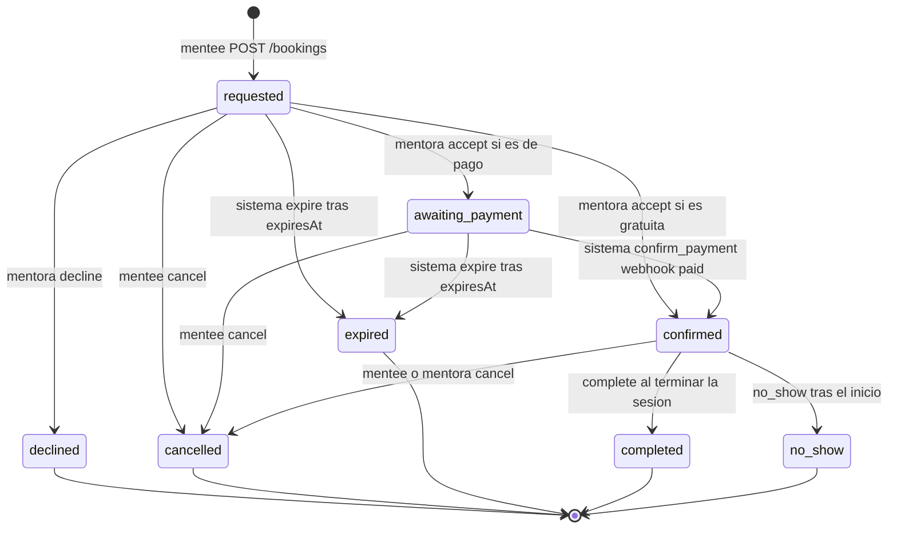
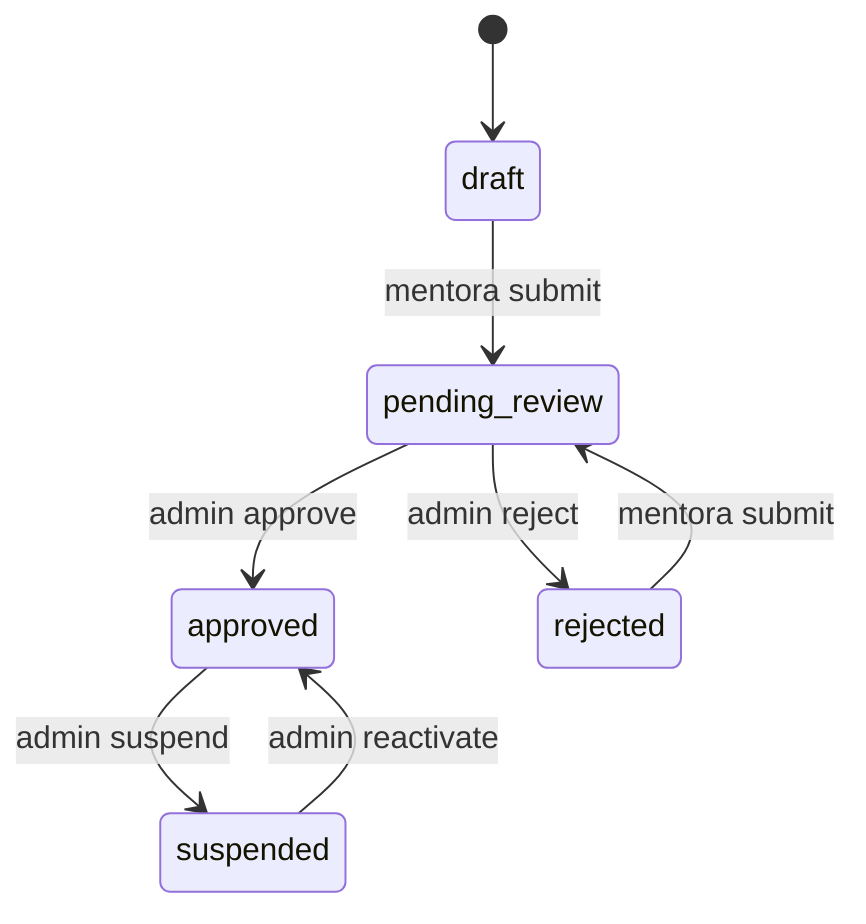
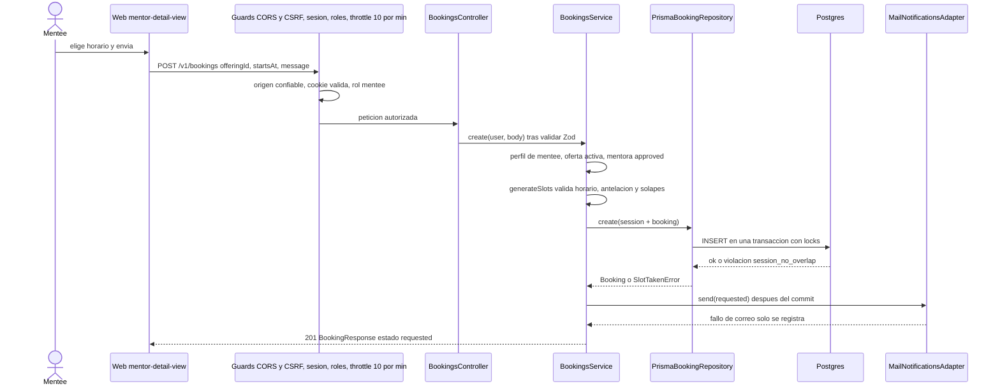
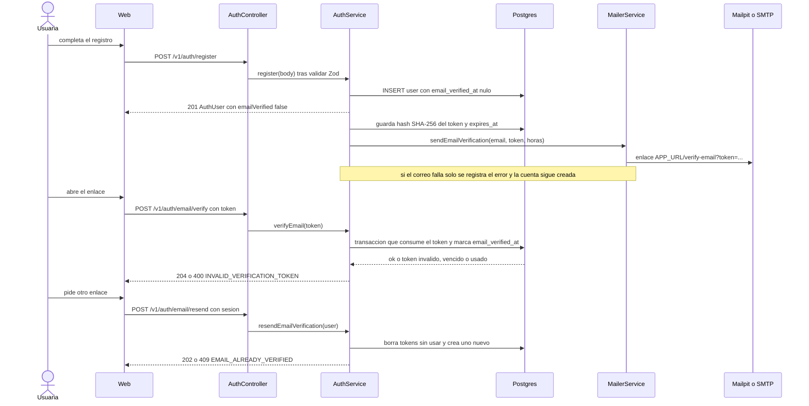
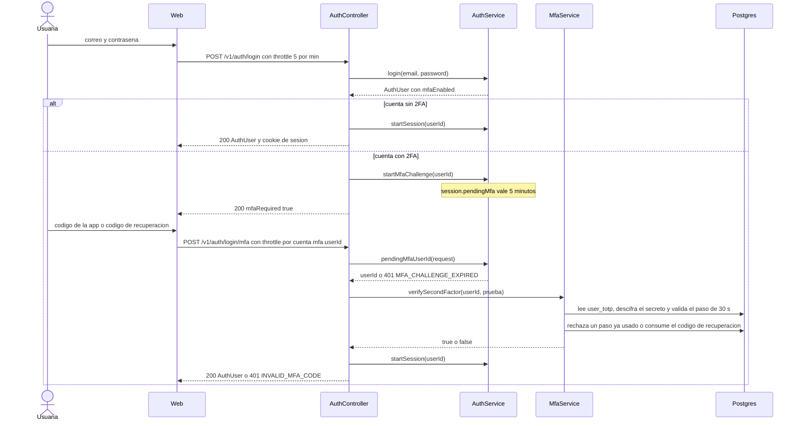

# FLOWS · Mapa visual del sistema

Guía rápida con diagramas para orientarse antes de tocar código. Todo está sacado del código real (backend `src/`, web `../frontend-steam-society/src/`). Si un doc y el código discrepan, manda el código. Para pagos en detalle ver [PAYMENTS.md](PAYMENTS.md); para reglas de producto, [01-PRODUCT.md](01-PRODUCT.md).

## 1. Mapa del sistema

- La web (Next.js 16, App Router) llama a la API directo desde el navegador con `credentials: "include"`; no hay BFF ni proxy (`../frontend-steam-society/src/lib/api/client.ts`, `AGENTS.md`).
- La API vive en `/v1` (excepto `/health`); se configura en `src/app.setup.ts`, que también monta Helmet, CORS y sesiones.
- Sesión: cookie `httpOnly`, `sameSite=lax`, 7 días, guardada en Postgres (tabla `auth_session`, `connect-pg-simple`).
- CSRF: no hay token; `app.enableCsrfProtection({ trustedOrigins })` valida el origen contra `WEB_ORIGIN` (`src/shared/config/web-origins.ts`).
- El correo sale por `MailerService` (`src/modules/auth/mailer.service.ts`) con `SMTP_URL`; si no está definido, no envía.

## 2. Módulos del backend y sus dependencias

- Las flechas son los `imports` reales de cada `*.module.ts` bajo `src/modules/` (más `src/app.module.ts`).
- `bookings` NO importa `payments`: solo expone `getPayable` y `confirmPayment` en `BookingsService`, y `payments` los llama por un adaptador (`src/modules/payments/infrastructure/bookings-booking-payment.adapter.ts`).
- `PrismaModule` (`src/shared/prisma/`) no es global: cada módulo que toca datos lo importa. `health` vive en `src/health/`.
- `auth` exporta `AuthService` y `MailerService`, y registra los guards globales (`APP_GUARD`) de sesión y roles.
- Las flechas son imports reales de TypeScript (tipos, decoradores, servicios y puertos), no solo los `imports` de los `*.module.ts`: por ejemplo `profiles`, `scheduling` y `matching` usan `CurrentUser`/`AuthUser` de `auth`. `scripts/check-boundaries.mjs` congela este grafo: una flecha nueva falla el lint hasta registrarla con un ADR.

## 3. Capas dentro de un módulo

- Dirección permitida: `presentation → application → domain`; `infrastructure` implementa los puertos de `application` y puede usar `domain`. `domain` no importa Nest ni Prisma (`docs/02-ARCHITECTURE.md`).
- Ejemplo completo: `src/modules/bookings/` (`domain/booking-status.ts`, `application/bookings.service.ts` + `ports/`, `infrastructure/prisma-booking.repository.ts`, `presentation/bookings.controller.ts`).
- No todos los módulos son hexagonales: `profiles` y `auth` son planos (controller, service, repository en la misma carpeta); `catalog` solo tiene `application` y `presentation`; `matching` es una función pura (`domain/recommend.ts`) con un servicio fino.
- Los módulos se comunican por servicios y puertos exportados, nunca leyendo tablas ajenas.

## 4. Recorrido de la mentee

- Login en `/login` (`POST /v1/auth/login`); tras entrar, `homePathForRole` manda a mentee y mentora a `/dashboard` y al admin a `/admin` (`src/lib/auth/roles.ts`). Rutas privadas protegidas por `require-auth.tsx`.
- Reservas y pagos se ven en `/dashboard/bookings` (`bookings-view.tsx`); acciones: `GET /v1/bookings`, `POST /v1/bookings/:id/cancel`, `/no-show`. El pago de prueba usa `/payments/fake-checkout`.
- La mentee debe tener perfil de mentee para solicitar (`menteeProfileRequired` en `bookings.service.ts`).
- Verificación de correo: NO existe hoy. `prisma/schema.prisma` da `status = active` por defecto y no hay endpoint de verificación; el paso "verificar correo" aún no está construido.
- Un pago real queda desactivado por defecto (`GET /v1/payments/config`): el piloto solo tiene sesiones gratuitas.

## 5. Recorrido de la mentora

- Pantallas en `../frontend-steam-society/src/app/(app)/dashboard/*` y `(app)/admin`; el menú sale de `src/components/layout/app-header.tsx`.
- Aceptar una reserva gratuita exige `meetingUrl`: la API no genera enlaces de video (`docs/04-STATE-MACHINES.md`).
- `complete` solo es válido desde `endsAt`; `no-show` solo después de `startsAt` (guardas en `booking-status.ts`).
- Solo perfiles `approved` aparecen en el catálogo y en las recomendaciones; el admin también puede `suspend` y `reactivate`.

## 6. Ciclo de vida de la reserva

- Fuente de verdad: `transitionBooking` en `src/modules/bookings/domain/booking-status.ts` (función pura con test exhaustivo en `booking-status.spec.ts`).
- Matices del código: la mentora solo puede cancelar desde `confirmed`; la mentee desde `requested`, `awaiting_payment` o `confirmed`. Una reserva gratuita confirmada solo se cancela antes de `startsAt`; una de pago, antes de `endsAt`.
- Vencimiento: tarea `@Interval(60_000)` en `infrastructure/bookings-expiration.task.ts` más evaluación al leer; `expiresAt = min(solicitud + BOOKING_REQUEST_TTL_HOURS, startsAt)`.
- Cada transición hace `UPDATE ... WHERE status = <leído>`; si cambió, responde `409 BOOKING_STATUS_CONFLICT`.

## 7. Ciclo de vida del perfil de mentora

- Tabla en `src/modules/profiles/domain/mentor-status.ts`; los endpoints están en `src/modules/profiles/profiles.controller.ts` (`/me/profile/submit` y `/admin/mentors/:id/{approve,reject,suspend,reactivate}`).
- Solo `approved` es visible públicamente. El perfil es editable en cualquier estado y editar no cambia `status`.
- Conflicto de estado concurrente: `409 MENTOR_STATUS_CONFLICT`. Las acciones del admin y el envío se auditan en `audit_log`.

## 8. Secuencia de una solicitud de reserva

- Guards: `SessionAuthGuard` y `RolesGuard` son globales (`auth.module.ts`); el throttle y `@Roles('mentee')` están en `src/modules/bookings/presentation/bookings.controller.ts`.
- Validación de horario con `generateSlots` (`src/modules/scheduling/domain/slot-generator.ts`).
- Red de seguridad en BD: restricción de exclusión `session_no_overlap` (`prisma/migrations/20261030234248_add_sessions_and_bookings/`) y error `SlotTakenError` mapeado a `bookingSlotTaken`.
- El correo se envía tras el commit; si falla, la reserva sigue válida (ADR-022).

## 9. Registro y verificación de correo (ADR-024)

- Sin verificar, la usuaria entra y navega. `AccountPolicyGuard` (`src/modules/auth/account-policy.guard.ts`) responde `403 EMAIL_NOT_VERIFIED` solo en rutas con `@RequireVerifiedEmail` (`POST /v1/bookings`, `POST /v1/me/profile/submit`).
- Solo se guarda el hash del token; reenviar invalida los enlaces anteriores.

## 10. Login con 2FA (ADR-024)

- El admin sin 2FA entra, pero `AccountPolicyGuard` responde `403 MFA_ENROLLMENT_REQUIRED` en todo salvo las rutas con `@AllowWithoutMfa` (`/me`, logout, `/me/mfa/*`, reenvío de verificación). Debe activar el 2FA con `POST /v1/me/mfa/totp/setup` y `totp/confirm`.
- El secreto TOTP se cifra con AES-256-GCM (`secret-box.ts`, `MFA_ENCRYPTION_KEY`). Detalle de las tablas en `docs/03-DATA-MODEL.md`.

## 11. Dónde tocar qué

| Si quieres cambiar... | Archivos |
|---|---|
| Reglas/transiciones de la reserva | `src/modules/bookings/domain/booking-status.ts` (+ `.spec.ts`), `application/bookings.service.ts` |
| Plazo de respuesta de solicitudes | `BOOKING_REQUEST_TTL_HOURS` en `src/config/env.ts`; tarea en `bookings/infrastructure/bookings-expiration.task.ts` |
| Cálculo de horarios libres, antelación | `src/modules/scheduling/domain/slot-generator.ts`, `availability-rule.ts` |
| Pesos y razones del matching | `src/modules/matching/domain/matching.config.ts`, `recommend.ts`; doc `docs/08-MATCHING.md` |
| Preguntas del onboarding | `src/modules/profiles/onboarding.config.ts`, `onboarding.completion.ts`; web `src/components/onboarding/` |
| Correos de reserva | `src/modules/bookings/infrastructure/mail-notifications.adapter.ts` |
| Correo de restablecer contraseña / verificación / SMTP | `src/modules/auth/mailer.service.ts`, `SMTP_URL`/`SMTP_FROM` en `src/config/env.ts` |
| Verificación de correo y cuáles rutas la exigen | `@RequireVerifiedEmail` (`src/shared/http/account-policy.decorators.ts`), `account-policy.guard.ts`, `EMAIL_VERIFICATION_TTL_HOURS` |
| 2FA (TOTP, códigos de recuperación, roles obligados) | `src/modules/auth/{mfa.service,mfa.controller,mfa.repository,totp,secret-box}.ts`; roles obligados en `MFA_REQUIRED_ROLES`; `@AllowWithoutMfa` en rutas |
| Pagos y proveedor | `src/modules/payments/` (`PaymentGateway`, adaptadores); ver `docs/PAYMENTS.md`; web `src/components/payments/`, `src/lib/api/payments.ts` |
| Roles y permisos de un endpoint | `@Roles(...)` en el controller; `src/modules/auth/roles.guard.ts`, `src/shared/http/roles.decorator.ts` |
| Sesión, cookie, CORS, CSRF | `src/app.setup.ts`, `src/shared/config/web-origins.ts`, `WEB_ORIGIN` |
| Límites de peticiones (throttle) | `@Throttle` en cada controller; configuración base en `src/modules/auth/auth.module.ts` |
| Estados del perfil de mentora | `src/modules/profiles/domain/mentor-status.ts`, `profiles.service.ts` |
| Textos y pantallas de la web | `../frontend-steam-society/src/components/*` y `src/app/*`; llamadas a la API en `src/lib/api/*.ts`; redirecciones por rol en `src/lib/auth/roles.ts` |
| Esquema de datos / constraints | `prisma/schema.prisma`, `prisma/migrations/`; ver `docs/03-DATA-MODEL.md` |
