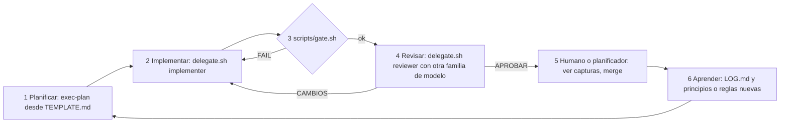

# Arnés de agentes (harness)

Cómo trabajamos con agentes de IA en Steam Society. Se inspira en [Harness engineering (OpenAI, 2026)](https://openai.com/index/harness-engineering/), adaptado a un equipo de una persona que usa modelos baratos o gratuitos.

**Idea central:** los humanos dirigen y los agentes ejecutan. Cuando un agente falla, no se le insiste. Se pregunta **qué le faltó**: un documento, una regla, una herramienta o un test. Eso se agrega al repo, para que la próxima vez no falle. Ese "qué le faltó" se anota en [`docs/harness/LOG.md`](harness/LOG.md).

## Las piezas

| Pieza | Dónde | Para qué |
|---|---|---|
| Mapa | `AGENTS.md` de cada repo (corto) → `docs/00-INDEX.md` | El agente sabe dónde buscar sin cargarlo todo |
| Fuente de verdad | `docs/*.md`, `docs/FLOWS.md` (diagramas) | Lo que no está en el repo, para el agente no existe |
| Principios de oro | [`docs/GOLDEN-PRINCIPLES.md`](GOLDEN-PRINCIPLES.md) | 14 reglas concretas nacidas de errores reales |
| Reglas en código | `scripts/check-boundaries.mjs` (en ambos repos, dentro de `pnpm lint`) | Bloquean imports prohibidos y le dicen al agente **cómo corregir** |
| Gate | `scripts/gate.sh` (en ambos repos) | Un solo comando con todas las verificaciones y salida corta |
| Ojos | `frontend/scripts/ui-shots.mjs` + `scripts/ui-plans/*.json` | El agente abre la app en un navegador, saca capturas y lee el texto |
| Planes | [`docs/exec-plans/`](exec-plans/) (`TEMPLATE.md`, `active/`, `completed/`, `tech-debt-tracker.md`) | Tareas escritas, con criterio de terminado y bitácora |
| Roles | [`docs/harness/roles/`](harness/roles/) (implementador, revisor, jardinero) | Instrucciones reutilizables para cualquier motor |
| Delegador | `scripts/harness/delegate.sh` | Manda una tarea a Sonnet, Haiku, Codex, agy u opencode con el rol correcto |
| Subagentes de Claude Code | `.claude/agents/*.md` | Los mismos roles dentro de Claude Code |

## El ciclo



1. **Planificar** (Claude Opus o tú). Copia `docs/exec-plans/TEMPLATE.md` a `active/`. Lista cerrada de archivos, criterio de terminado y fuera de alcance. Si la tarea no cabe en una pantalla, divídela.
2. **Implementar**: `scripts/harness/delegate.sh <motor> implementer <plan.md> [repo]`.
3. **Gate**: el implementador lo corre solo. El planificador lo vuelve a correr (no se confía en el informe).
4. **Revisar** con un modelo de **otra familia**, porque los errores de un modelo los ve mejor otro: si implementó Claude, revisa Codex o agy, y viceversa.
5. **Integrar**: para la web, `pnpm ui:shots scripts/ui-plans/<plan>.json` y mirar las capturas. Luego el merge según la política git de `AGENTS.md`.
6. **Aprender**: cada fallo del agente → una fila en `docs/harness/LOG.md` → una regla en `GOLDEN-PRINCIPLES.md`, en `check-boundaries` o un test.

## Qué motor usar

| Dificultad | Ejemplos | Implementa | Revisa |
|---|---|---|---|
| Baja | Textos, estilos, renombrar, un test faltante, docs | `haiku` u `opencode` (gratis) | `sonnet` |
| Media | Un componente nuevo, un endpoint con tests, refactor de un módulo | `sonnet` o `codex` | `codex` / `sonnet` (el otro) |
| Alta | Zonas rojas (reservas, pagos, auth, migraciones), diseño | Planificador (Opus) | `codex` + `sonnet` |

Estado real de los motores (2026-11-17):
- **sonnet / haiku** (`claude -p`): implementan y revisan.
- **codex**: modelo `gpt-6-luna` (por defecto en `delegate.sh`). Es la cuota gratuita de la cuenta de ChatGPT y **se terminará**. Cuando falle por cuota, usa opencode.
- **agy**: solo como **revisor** (modo `plan`, permisos de lectura por sesión con `--settings`; cada regla necesita destino, por ejemplo `read_file(<repo>/**)`). Ojo: sus reglas no limitan de verdad qué archivos lee (probado: leyó `.env.example` fuera del alcance y sin hacer caso a `deny`), así que, igual que con codex en solo lectura, no abrir `.env` depende de la instrucción del rol. En modo headless edita mediante comandos de shell, así que como implementador necesitaría un shell completo, y no se lo damos.
- **opencode** con modelos gratuitos (por ejemplo `deepseek-v4.1-flash-free`): implementa tareas bajas y revisa. Envía el código a terceros.

Reglas de seguridad de los motores:
- **opencode gratis** envía el código a proveedores de terceros. Úsalo solo en tareas sin secretos ni datos personales. Nunca en zonas rojas.
- Ningún motor hace commit, push ni merge: el rol lo prohíbe y el planificador integra.
- Revisor y jardinero corren en solo lectura (`claude --disallowedTools Edit Write`, `codex -s read-only`, `agy --mode plan`, `opencode --agent plan`).

## Comandos

```bash
# Gate (todas las verificaciones, salida corta)
scripts/gate.sh            # backend rápido; 'full' agrega e2e (Postgres en 5433)
../frontend-steam-society/scripts/gate.sh

# Solo reglas de arquitectura
pnpm lint:arch

# Delegar
scripts/harness/delegate.sh sonnet   implementer docs/exec-plans/active/<plan>.md ../frontend-steam-society
scripts/harness/delegate.sh codex    reviewer    docs/exec-plans/active/<plan>.md ../frontend-steam-society
MODEL=opencode/glm-5.3-flash-free scripts/harness/delegate.sh opencode doc-gardener docs/harness/tasks/garden-all.md

# Ver la app (web y API levantadas)
cd ../frontend-steam-society && DEMO_PASSWORD=... pnpm ui:shots scripts/ui-plans/smoke.json   # → .shots/smoke/
```

Los resultados de cada delegación quedan en `<repo>/.harness/runs/` (ignorado por git).

## Limpieza continua (recolección de basura)

Los agentes copian los patrones que ven, incluidos los malos. En vez de limpiar en grandes sesiones, se paga poco y seguido:
- **Jardinero de documentación** al cerrar cada etapa o cada semana: `scripts/harness/delegate.sh sonnet doc-gardener docs/harness/tasks/garden-all.md`. Sus hallazgos van a `docs/exec-plans/tech-debt-tracker.md`, y los que son solo de texto se arreglan con una tarea de dificultad baja.
- **Deuda técnica**: `tech-debt-tracker.md` se revisa al planificar cada etapa.
- **Promover reglas**: si un revisor encuentra el mismo error dos veces, se convierte en principio de oro. Si se puede verificar con código, va a `check-boundaries.mjs`, al lint o a un test.

## Diferencias con OpenAI (a propósito)

- OpenAI casi no bloquea los merges porque integra cientos de PRs y corregir le sale barato. Aquí hay **gates estrictos**: los modelos son más débiles y gratuitos, y hay una sola persona revisando.
- No hay un stack de observabilidad por worktree. Por ahora basta con los logs de la API y `ui-shots`. Se reconsidera cuando haya despliegue.
- Los agentes en segundo plano programados (cron) se activan a mano. El jardinero se puede programar después, cuando hayamos medido su utilidad.
