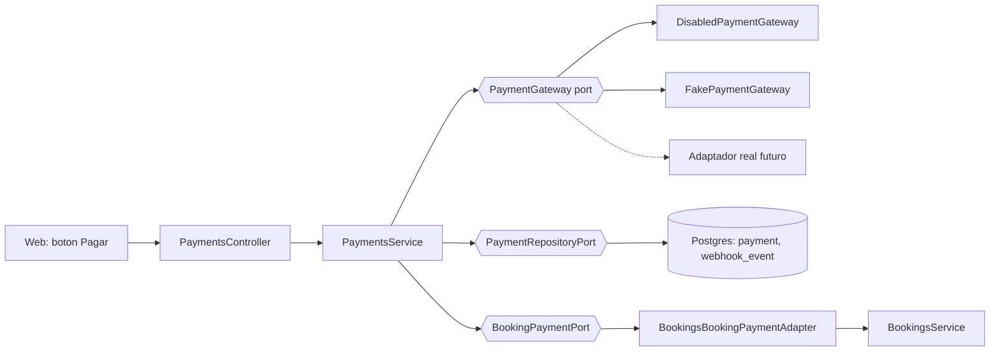
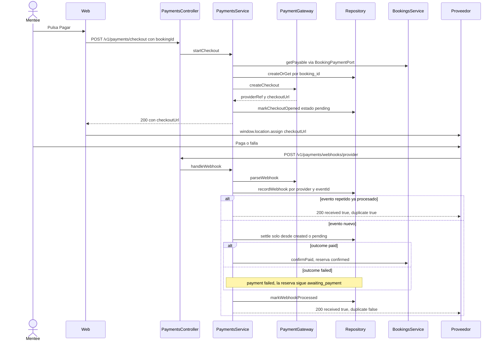
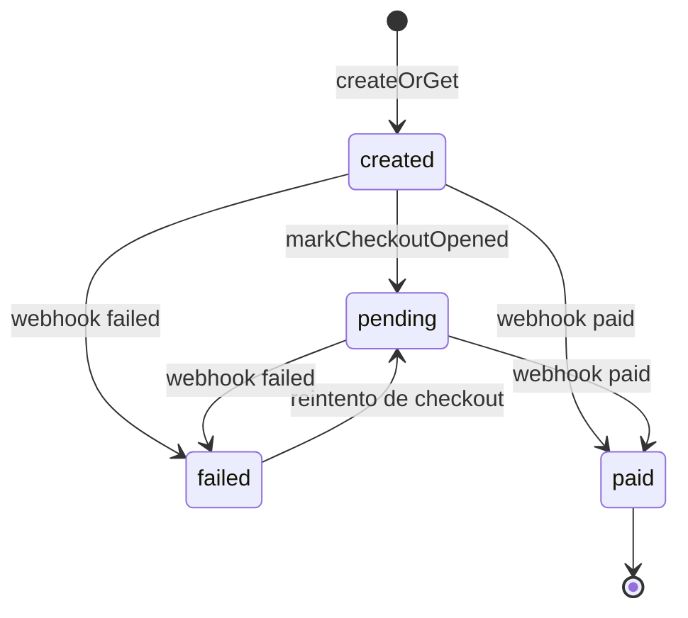

# Pagos: guía para conectar un proveedor real

Módulo: `src/modules/payments/` (ADR-010, ADR-025, ADR-026). Esta guía describe lo que **existe hoy**; lo que falta se marca como pendiente.

## 1. Resumen

1. Hoy el módulo cobra una reserva de pago (`awaiting_payment`) mediante un checkout alojado por el proveedor y confirma la reserva cuando llega el webhook `paid`.
2. Proveedores disponibles: `disabled` (por defecto, el piloto solo tiene sesiones gratuitas) y `fake` (solo desarrollo, no mueve dinero).
3. Calcula y guarda la comisión (`fee_bps`, `fee_minor`, `net_minor`) pero no la usa para nada más.
4. NO hay ledger, reembolsos, payouts ni conciliación (Hito 2, DA-05).
5. Cambiar de proveedor = escribir un adaptador de `PaymentGateway`; nada más del módulo cambia.

## 2. Componentes



`BookingsService` no importa nada de `payments`: solo expone `getPayable(user, id)` y `confirmPayment(id)`, que el adaptador llama. La dependencia va en una sola dirección (payments → bookings). Ojo: el esquema Prisma sí tiene la relación inversa `Booking.payment Payment?` (ver sección 9).

## 3. Flujo completo



Camino fallido: `settle(failed)` deja el pago en `failed`; la reserva sigue en `awaiting_payment` y el mentee puede reintentar con otro `POST /checkout` (genera un `providerRef` nuevo). Un resultado tardío del intento anterior no liquida el nuevo porque `settle` busca por `(provider, providerRef)`.

## 4. Estados del pago



`paid` es terminal hoy (sin reembolsos). `settle` solo actúa desde `created|pending` (`SETTLEABLE_STATUSES`); el checkout solo se abre desde `created|failed` (`RESTARTABLE_STATUSES`). Con el pago en `pending` y `checkoutUrl` se reutiliza el checkout abierto.

## 5. Configuración y API

| Variable | Valores | Detalle |
|---|---|---|
| `PAYMENTS_PROVIDER` | `disabled` (defecto) o `fake` | Enum zod en `src/config/env.ts`. Con `NODE_ENV=production` y `fake` la API no arranca. |
| `PAYMENTS_FEE_BPS` | entero 0 a 10000, defecto 1500 | 1500 = 15 %. Redondeo half-up (`splitFee`). Provisional (ADR-026). |
| `APP_URL` | URL, defecto `http://localhost:3001` | Base del `returnUrl` (`${APP_URL}/dashboard/bookings`) y del checkout `fake` (`/payments/fake-checkout`). |
| `NODE_ENV` | texto libre | Solo importa el valor `production` para las restricciones de arriba. |

Errores con formato `{ statusCode, code, message }`:

| Endpoint | Auth | Request | Respuesta 200 |
|---|---|---|---|
| `GET /v1/payments/config` | público | sin cuerpo | `{ enabled, provider }` |
| `POST /v1/payments/checkout` | rol `mentee` | `{ bookingId: uuid }` (strict) | `{ paymentId, bookingId, status, provider, amountMinor, currency, checkoutUrl }` |
| `POST /v1/payments/webhooks/:provider` | público, 60 por minuto | cuerpo según el proveedor; `:provider` debe cumplir `^[a-z][a-z0-9_-]{1,31}$` | `{ received: true, duplicate: boolean }` |

| Código | HTTP | Cuándo |
|---|---|---|
| `PAYMENTS_DISABLED` | 503 | Proveedor `disabled` en checkout. |
| `PAYMENT_ALREADY_PAID` | 409 | Ya hay un pago `paid` para la reserva. |
| `PAYMENT_STATUS_CONFLICT` | 409 | El pago cambió de estado durante la petición. |
| `PAYMENT_PROVIDER_NOT_FOUND` | 404 | `:provider` mal formado, distinto del activo o `disabled`. |
| `INVALID_WEBHOOK` | 400 | El gateway lanzó `InvalidWebhookError`. |
| `BOOKING_NOT_AWAITING_PAYMENT`, `BOOKING_EXPIRED`, `BOOKING_NOT_FOUND` | 409, 409, 404 | Vienen de `BookingsService.getPayable`. |

## 6. Garantías e invariantes

- **Un pago por reserva:** `payment.booking_id` es UNIQUE; `createOrGet` resuelve la carrera ante P2002 devolviendo la fila ganadora.
- **Idempotency key:** `booking:<bookingId>` (UNIQUE). Al proveedor se le envía `<key>:<updatedAt en ms>`, que cambia en cada reintento.
- **Doble clic:** `pending` con `checkoutUrl` devuelve el mismo checkout sin llamar al proveedor.
- **Dedupe de webhooks:** `INSERT ... ON CONFLICT (provider, event_id) DO NOTHING`. Si el evento ya existe pero `processed_at IS NULL` (falló a medias) se reprocesa; si no, responde `duplicate: true`.
- **Liquidación:** `UPDATE ... WHERE provider, provider_ref y status IN (created, pending)`; `count` distinto de 1 es no-op (referencia desconocida: solo `warn`).
- **Confirmación:** tras `paid` se llama `bookings.confirmPaid`; si falla se registra `error` y el webhook igual responde 200.
- **CHECKs** (migración `20261116213734_add_payments`): `amount_minor > 0`; `currency ~ '^[A-Z]{3}$'`; `fee_bps` entre 0 y 10000; `fee_minor >= 0 AND net_minor >= 0`; `fee_minor + net_minor = amount_minor`; `(status = 'paid') = (paid_at IS NOT NULL)`. Además `provider_ref` UNIQUE y FK `booking_id` con `ON DELETE RESTRICT`.
- **R-07:** una reserva gratuita nunca se cobra: `getPayable` exige `status = awaiting_payment`, `paymentRequired = true` y `priceMinor > 0`; si no, `BOOKING_NOT_AWAITING_PAYMENT`.

## 7. Cómo conectar un proveedor real

Candidatos: Mercado Pago, Culqi, Izipay. Todo detalle propio del proveedor va como **[verificar en la documentación del proveedor]**.

1. **Spike en sandbox primero.** Antes de escribir código, probar a mano con las credenciales de prueba: crear un cobro con checkout alojado, pagar, rechazar y ver el webhook real (cabeceras, cuerpo, firma, reintentos). [verificar en la documentación del proveedor]
2. **Crear** `src/modules/payments/infrastructure/<provider>-payment.gateway.ts` con la interfaz exacta del puerto (`application/ports/payment-gateway.port.ts`):

```ts
import {
  InvalidWebhookError,
  type CheckoutSession,
  type CreateCheckoutInput,
  type GatewayEvent,
  type PaymentGateway,
  type WebhookRequest,
} from '../application/ports/payment-gateway.port.js';

export class MiProveedorPaymentGateway implements PaymentGateway {
  readonly provider = 'miproveedor'; // minusculas, 2 a 32 chars, ^[a-z][a-z0-9_-]{1,31}$

  constructor(private readonly secrets: { apiKey: string; webhookSecret: string }) {}

  async createCheckout(input: CreateCheckoutInput): Promise<CheckoutSession> {
    // input: { paymentId, idempotencyKey, amountMinor, currency, description, returnUrl }
    // Enviar idempotencyKey al proveedor si lo admite y paymentId como referencia externa.
    // [verificar en la documentación del proveedor] unidad del monto (centimos?) y moneda PEN.
    return { providerRef: '<id del cobro>', checkoutUrl: '<url de pago>' };
  }

  async parseWebhook(request: WebhookRequest): Promise<GatewayEvent> {
    // 1) Verificar autenticidad (firma/HMAC); si falla: throw new InvalidWebhookError();
    // 2) Mapear estado del proveedor a 'paid' | 'failed'.
    // 3) Devolver { eventId, providerRef, outcome, payload }.
    throw new InvalidWebhookError();
  }
}
```

3. **Verificar la firma dentro de `parseWebhook`** y lanzar `InvalidWebhookError` (el servicio la convierte en `INVALID_WEBHOOK` 400). El webhook es público: sin firma cualquiera podría marcar pagos como `paid`. [verificar en la documentación del proveedor] algoritmo, cabecera y ventana de tiempo.
4. **Mapear estados:** el servicio solo entiende `outcome: 'paid' | 'failed'`. Los estados intermedios del proveedor (pendiente, en proceso) NO deben producir evento; hoy el puerto no tiene un resultado "ignorar", así que decidir cómo tratarlos (por ejemplo `InvalidWebhookError` o ampliar el puerto) es un punto abierto. `eventId` debe ser único y estable por evento (≤128 chars) porque es la clave de dedupe; `providerRef` debe coincidir con el devuelto por `createCheckout` (≤128, UNIQUE).
5. **Registrar** el adaptador en el `switch` de `useFactory` en `payments.module.ts` (hoy solo `case 'fake'`; `default` devuelve `DisabledPaymentGateway`). Leer secretos con `config.getOrThrow`.
6. **Agregar el valor** al enum `PAYMENTS_PROVIDER` en `src/config/env.ts` (hoy `['disabled', 'fake']`) y a `.env.example`. Las variables de secretos nuevas también deben validarse en el esquema zod.
7. **Secretos solo por variables de entorno**; nunca en el repositorio, en logs ni en el `payload` guardado en `webhook_event` si contiene datos sensibles.
8. **Cuerpo crudo (raw body):** muchas firmas HMAC se calculan sobre los bytes exactos del cuerpo. El controlador actual recibe el JSON ya parseado (`@Body() body: unknown`) y `WebhookRequest` solo tiene `headers` y `body`; no existe acceso al cuerpo crudo. **Punto a verificar con el proveedor elegido** si su firma lo necesita; si sí, habrá que habilitar y exponer el raw body (no está implementado).
9. **Webhook URL:** registrar en el panel del proveedor `https://<api>/v1/payments/webhooks/<provider>`. Responder 200 rápido; el proveedor reintenta y el dedupe lo absorbe. [verificar en la documentación del proveedor]
10. **Tests a agregar:** unitarios del gateway (firma válida, firma inválida, cuerpo mal formado, mapeo de estados, `createCheckout` con el cliente HTTP simulado); e2e que repliquen `describe('payments (fake provider)')` de `test/bookings.e2e-spec.ts` (cobro y confirmación, webhook duplicado, fallo y reintento) usando un gateway de prueba.
11. **Antes de producción:** pasar `NODE_ENV=production` con el proveedor real, probar en sandbox de extremo a extremo y revisar los riesgos de la sección 8.

## 8. Riesgos conocidos y pendientes

- Pago acreditado sobre una reserva ya vencida: queda `paid`, la reserva no se confirma y solo hay un log `error`. Requiere reembolso (Hito 2, DA-05) y seguimiento manual.
- El webhook `fake` no lleva firma: solo desarrollo; un proveedor real DEBE verificarla en `parseWebhook`.
- El plazo de pago reutiliza el `expires_at` de la solicitud (como máximo `starts_at`); se decidirá un plazo propio en el Hito 2.
- Comisión (`PAYMENTS_FEE_BPS`) y política de cancelación y reembolso deben pasar a configuración editable por el admin (ADR-026, F3/F4); hoy la comisión es una variable de entorno.
- Sin ledger, reembolsos, payouts ni conciliación; cancelar una reserva de pago ya pagada no devuelve dinero.
- Sin tarea periódica para pagos `pending` que nunca reciben webhook.

## 9. Cómo quitar el módulo por completo

1. Backend `src/app.module.ts`: quitar el import y `PaymentsModule` de `imports`.
2. Borrar la carpeta `src/modules/payments/`.
3. `src/config/env.ts`: quitar `PAYMENTS_PROVIDER`, `PAYMENTS_FEE_BPS` y el `refine` de producción; quitar ambas del `.env.example`.
4. Prisma: quitar `model Payment`, `model WebhookEvent`, el enum `PaymentStatus` y la línea `payment Payment?` de `model Booking` (aquí bookings sí referencia el modelo en el esquema), y crear una migración que borre las tablas `payment` y `webhook_event` y el tipo `payment_status`. No editar la migración ya aplicada.
5. Quitar de `test/bookings.e2e-spec.ts` el bloque `describe('payments (fake provider)')`.
6. Web: borrar `src/lib/api/payments.ts` y `payments.test.ts`, `src/components/payments/fake-checkout-view.tsx`, la ruta `src/app/(app)/payments/fake-checkout/page.tsx`, y en `bookings-view.tsx` el botón Pagar y `handlePay`.
7. `BookingsService.getPayable` y `confirmPayment` pueden quedarse (sin consumidor) o borrarse con sus tests. Actualizar README y docs.
8. Correr `pnpm build`, `pnpm lint` y los tests.

## 10. Notas de código relevantes

- Web: `handlePay` llama `startCheckout(booking.id)` y hace `window.location.assign(checkout.checkoutUrl)`. El checkout `fake` (`fake-checkout-view.tsx`) lee `?ref=`, hace `POST /payments/webhooks/fake` con `{ eventId, providerRef, outcome }` y redirige a `/dashboard/bookings?payment=paid|failed`.
- El webhook `fake` valida con zod estricto: `eventId`, `providerRef` que empieza con `fake_` y `outcome`.
- No hay transacción que envuelva `settle` + `confirmPaid` + `markWebhookProcessed`: son pasos secuenciales.
